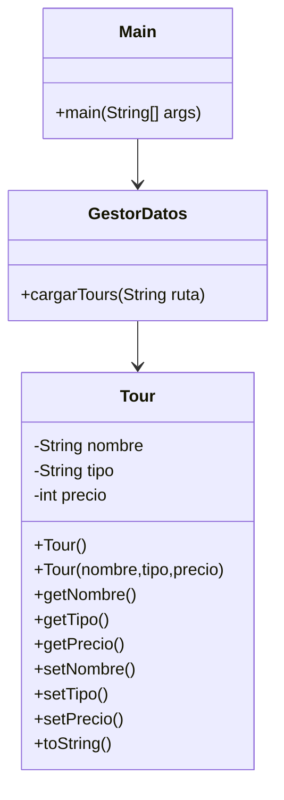

# 🌋 Llanquihue Tour App

### Sistema de gestión de tours turísticos del sur de Chile

*Aventura entre volcanes, lagos y paisajes únicos de la Región de Los Lagos* 🌊

## 📑 Contenido

- Descripción
- Conceptos aplicados
- Estructura del proyecto
- Diagrama de clases
- Archivo de datos
- Cómo ejecutar
- Salida de ejemplo
- Mejoras futuras
- Autora

---

## 📋 Descripción

**Llanquihue Tour App** es una aplicación desarrollada en Java que permite cargar y gestionar información de tours turísticos desde un archivo de texto.

La aplicación lee los datos almacenados en un archivo `.txt`, crea objetos de tipo `Tour` y posteriormente muestra la información por consola.

Además, incorpora un filtro que permite visualizar únicamente aquellos tours cuyo precio sea superior a $20.000.

---

## 🧠 Conceptos aplicados

| Concepto | Aplicación |
|-----------|-----------|
| 🧱 Programación Orientada a Objetos | Representación de tours mediante la clase `Tour` |
| 🔒 Encapsulamiento | Uso de atributos privados con getters y setters |
| 📦 Organización por paquetes | Separación en `model`, `data` y `ui` |
| 📂 Lectura de archivos | Uso de `BufferedReader` y `FileReader` |
| 📋 Colecciones | Uso de `ArrayList<Tour>` |
| ⚠️ Manejo de excepciones | Captura de errores mediante `try-catch` |
| 📝 Text Blocks | Formato de salida mediante `"""` y `.formatted()` |

---

## 🗂️ Estructura del proyecto

```text
LLanquihue-Tourapp/
│
├── resources/
│   └── Tours.txt
│
├── src/
│   ├── data/
│   │   └── GestorDatos.java
│   │
│   ├── model/
│   │   └── Tour.java
│   │
│   └── ui/
│       └── Main.java
│
└── LLanquihue-Tourapp.iml
```

---

## 🧩 Diagrama de clases



---

## 📂 Archivo de datos

El sistema obtiene la información desde el archivo:

```text
resources/Tours.txt
```

Formato utilizado:

```text
Nombre;Tipo;Precio
```

Ejemplo:

```text
Volcan Osorno;Aventura;250000
Lago Todos Los Santos;Naturaleza;18000
Frutillar;Cultural;12000
Saltos del Petrohue;Naturaleza;22000
Puerto Varas;Gastronomico;85000
```

---

## 🚀 Cómo ejecutar

> [!IMPORTANTE]
> El proyecto fue desarrollado utilizando Java 23 y requiere JDK 15 o superior debido al uso de Text Blocks.

### Opción 1 · IntelliJ IDEA

1. Abrir el proyecto en IntelliJ IDEA.
2. Verificar que el JDK configurado sea Java 23.
3. Ejecutar la clase `Main.java`.

### Opción 2 · Terminal

Compilar:

```bash
javac -d out src/model/*.java src/data/*.java src/ui/*.java
```

Ejecutar:

```bash
java -cp out ui.Main
```

---

## 🖥️ Salida de ejemplo

```text
=== TODOS LOS TOURS ===

===== TOUR =====
Nombre: Volcan Osorno
Tipo: Aventura
Precio: $250000
=================

===== TOUR =====
Nombre: Lago Todos Los Santos
Tipo: Naturaleza
Precio: $18000
=================

===== TOUR =====
Nombre: Frutillar
Tipo: Cultural
Precio: $12000
=================

===== TOUR =====
Nombre: Saltos del Petrohue
Tipo: Naturaleza
Precio: $22000
=================

===== TOUR =====
Nombre: Puerto Varas
Tipo: Gastronomico
Precio: $85000
=================
```

### Tours filtrados

```text
=== TOURS SOBRE $20.000 ===

Volcan Osorno
Saltos del Petrohue
Puerto Varas
```

---

## 🔮 Mejoras futuras

- [ ] Validar el formato de los datos antes de crear objetos.
- [ ] Agregar búsqueda por tipo de tour.
- [ ] Ordenar tours por precio.
- [ ] Implementar menú interactivo por consola.
- [ ] Incorporar escritura de datos en archivos.
- [ ] Agregar pruebas unitarias con JUnit 5.
- [ ] Implementar interfaz gráfica con JavaFX.

---

## 👩‍💻 Autora

### Madeleine Saldivia
